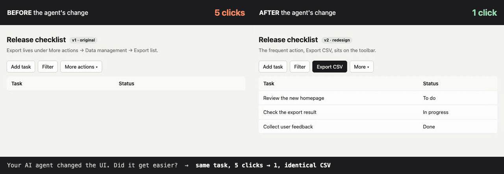

# shijing-agent

**Did your redesign actually make the task easier?**
Describe a task in plain English. An agent does it on both versions of your page, and you get a report on clicks, the path taken, and whether the output is identical.

[中文说明](README.zh-CN.md)



```text
$ npx shijing-agent demo

▶ Export the release checklist
  [baseline] 1. click "More actions ▾"
  [baseline] 2. click "Data management ▸"
  [baseline] 3. click "Export list"
  [baseline] 4. click "Choose CSV"
  [baseline] 5. click "Download CSV"
  [candidate] 1. click "Export CSV"

candidate completes the task in 1 click instead of 5 (-4) with identical output.
```

## Why

UI tests answer *"does it still work?"*. They don't answer *"is it easier now?"*, which is usually why you shipped the redesign.

shijing-agent behaves like a first-time user. It doesn't follow selectors you wrote. It reads the visible controls and picks the one that best fits the goal. So:

- **Clicks and the path are measured, not scripted.** If the new layout hides the action, the agent takes the longer path too.
- **Success is checked independently.** The downloaded bytes are compared with an expected file, or the page text is checked. The agent never grades itself.
- **Same task, same start, fresh browser.** Every target runs in a clean browser context with the same viewport and data.

## Quick start

Requirements: Node.js 20+ and Chromium (`npx playwright install chromium`) or Google Chrome (`--chrome`).

```bash
npx shijing-agent demo                 # built-in example: old vs new checklist page
npx shijing-agent run my-task.yaml     # your own task
npx shijing-agent demo --video         # also record what the agent did, per version
```

The report is written to `.shijing/runs/<time>/report.md`, along with `result.json`, the downloaded files and a final screenshot for each version. With `--video`, you also get one `.webm` per version with each click highlighted.

From source:

```bash
git clone https://github.com/gengsong/shijing-agent && cd shijing-agent
npm install && npx playwright install chromium
npm run demo
```

## Write your own task

```yaml
name: Export the release checklist
goal: Export the task list as a CSV file

targets:                       # first = baseline, last = candidate
  baseline: https://staging.example.com/checklist?ui=old
  candidate: https://staging.example.com/checklist?ui=new
  # local files work too: ./site/v1/index.html

success:                       # decided by checks, not by the agent
  download:
    name: "*.csv"
    equals: ./expected/checklist.csv   # optional byte-for-byte comparison
  # text: "Export complete"           # or/and: text the page must show

maxSteps: 10
```

Full reference: [docs/task-format.md](docs/task-format.md).

## Planners

| | `rules` (default) | `claude` |
|---|---|---|
| How it decides | Scores visible labels against the goal, opens menus when nothing matches yet | Claude reads the goal, history and visible controls and picks one action. Sonnet goes first; a target Sonnet can't finish is re-run from scratch with Opus |
| Cost | Free, offline, deterministic | Uses your API key ([pricing](https://platform.claude.com/docs/en/about-claude/pricing)); the report shows calls and estimated cost |
| Good for | CI, simple find / export / navigate tasks | Fuzzy wording, search boxes, unfamiliar layouts |

```bash
export ANTHROPIC_API_KEY=...        # bring your own key; nothing is sent anywhere else
npx shijing-agent run task.yaml --planner claude                         # Sonnet 5.5, then Opus 5.5 if needed
npx shijing-agent run task.yaml --planner claude --model claude-opus-5-5 # pin one model
```

The report's Planner row shows what ran, e.g. `sonnet-5-5 (failed) → opus-5-5 (passed) · 9 calls · ~$0.03`. Escalation only happens when a run *fails*. An error, such as a page that won't load, is not retried.

## Use it from an AI agent (MCP)

`shijing-agent mcp` starts an [MCP](https://modelcontextprotocol.io) server on stdio. Your coding agent can then check its own UI changes: *"I moved Export to the toolbar. Run compare_pages and see if it got easier."*

| Tool | What it does |
|---|---|
| `compare_pages` | Goal + baseline + candidate (URL or local HTML) + a check (`download_name`, `expected_file` and/or `success_text`). Returns the report and a JSON summary |
| `run_task_file` | Runs a task YAML |
| `run_demo` | Runs the built-in example, offline |

Claude Code:

```bash
claude mcp add shijing -- npx -y shijing-agent mcp
```

Claude Desktop, Cursor and other clients (`mcpServers` in their config):

```json
{
  "mcpServers": {
    "shijing": {
      "command": "npx",
      "args": ["-y", "shijing-agent", "mcp"],
      "env": { "ANTHROPIC_API_KEY": "only needed for planner: claude" }
    }
  }
}
```

Reports are written to `.shijing/runs/` in the server's working directory, or to `SHIJING_OUT_DIR` if it is set.

## Safety

The agent explores pages, so by default it is careful:

- It never presses controls that look like buying, paying, deleting, signing in or out, uploading, publishing or sending.
- It blocks non-GET requests (`allowWrites: true` in the task lifts this, but only use it on a staging environment).
- It stays on the target's origin. Pop-ups are closed and dialogs dismissed.
- A run stops after `maxSteps`.

Only run it against sites you own or are allowed to test.

## How it works

```
task.yaml ─▶ fresh browser ─▶ observe visible controls ─▶ planner picks one action ─▶ execute
                 ▲                                                                       │
                 └──────── not done yet ◀── independent checks (download bytes, text) ◀──┘
                                                         │ done / failed / max steps
                                                         ▼
                                       report.md · result.json · downloads · screenshots
```

Code map: `src/observe.js` (what a user can act on), `src/planners/` (rules, claude), `src/policy.js` (safety), `src/checks.js` (success), `src/run.js` (loop), `src/report.js` (comparison).

## Roadmap

- [x] v0.1: CLI, rules and Claude planners, download and text checks, Markdown report
- [x] Demo GIF and npm release
- [x] MCP server; Claude planner escalates Sonnet → Opus
- [ ] GitHub Action that comments the comparison on pull requests
- [ ] Eval set: 30 tasks across public demo sites, tracking success rate and cost per planner
- [ ] Form-filling tasks with test data, multi-page flows, mobile viewport presets

## Contributing

Issues and PRs are welcome, especially **tasks where the agent got it wrong**. Those become eval cases. See [CONTRIBUTING.md](CONTRIBUTING.md).

## License

[Apache-2.0](LICENSE)
