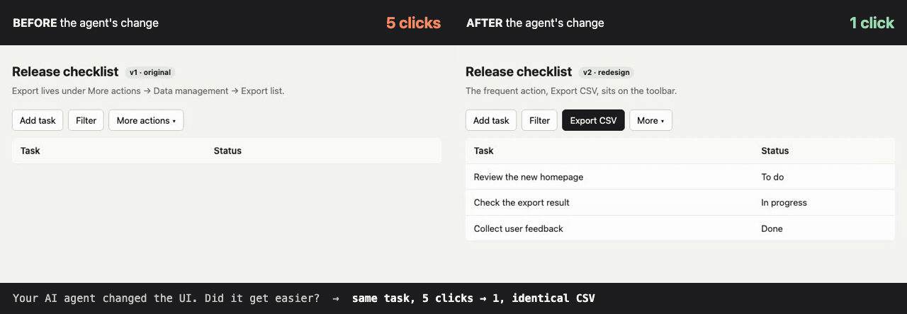

# shijing-agent（试径）

**改版之后，用户完成任务真的更容易了吗？**
用一句话描述任务，Agent 会在新旧两个版本的页面上各做一遍，然后报告点击次数、走过的路径，以及产出的文件是否一致。

[English](README.md)



```text
$ npx shijing-agent demo
...
candidate completes the task in 1 click instead of 5 (-4) with identical output.
```

## 为什么做这个

UI 自动化测试回答的是"还能不能用"，回答不了"是不是更好用了"，而后者往往才是改版的目的。

shijing-agent 像第一次使用的用户那样操作：它不按你写好的选择器执行，而是读取页面上可见的控件，挑最符合目标的那个。因此：

- **点击次数和路径是测出来的，不是写死的。** 新版把入口藏深了，Agent 也会多走几步。
- **结果由独立检查判定。** 系统会逐字节比对下载文件，或者检查页面文字，Agent 不给自己打分。
- **同一任务、同一起点、全新浏览器。** 每个版本都在干净的浏览器上下文里运行，视口和数据保持一致。

## 快速开始

需要 Node.js 20+，以及 Chromium（运行 `npx playwright install chromium` 安装）或本机 Chrome（加 `--chrome` 参数）。

```bash
npx shijing-agent demo                 # 内置示例：新旧两版清单页
npx shijing-agent run my-task.yaml     # 运行你自己的任务
npx shijing-agent demo --video         # 同时录下 Agent 在每个版本上的操作
```

国内网络如果安装慢，可以加上 `--registry=https://registry.npmmirror.com`。

报告保存在 `.shijing/runs/<时间>/report.md`，同目录下还有 `result.json`、下载的文件和每个版本的最终截图。加 `--video` 时，每个版本还会生成一段 `.webm` 录像，Agent 每次点击的位置都会高亮。

## 编写任务

写法见 [docs/task-format.md](docs/task-format.md)，示例见 `examples/export-csv/task.yaml`。

`task.control.yaml` 是对照用例：它故意把期望文件写成少一行，两个版本都必须判为失败。如果对照用例通过了，说明检查逻辑出了问题。

## 两种规划器

- `rules`（默认）：离线、免费、结果确定，适合 CI 和简单的查找、导出、导航任务。
- `claude`：使用你自己的 API Key（`ANTHROPIC_API_KEY`）。默认先用 Sonnet 5.5；某个版本 Sonnet 没完成，就用 Opus 5.5 从头再跑一遍。报告的 Planner 一行会写明实际用了哪些模型、调用次数和估算费用，例如 `sonnet-5-5 (failed) → opus-5-5 (passed)`。页面打不开这类错误不会升级重试。用 `--model` 可以固定只用一个模型。

## 在 AI Agent 里使用（MCP）

`shijing-agent mcp` 会启动一个 stdio 模式的 MCP Server，提供三个工具：
- `compare_pages`：传入目标、新旧两个版本和检查条件，返回对比报告。
- `run_task_file`：运行一个任务 YAML 文件。
- `run_demo`：离线运行内置示例。

一条命令接入本机找到的所有 Agent（Claude Code、Claude Desktop、Cursor、Codex）：

```bash
npx shijing-agent setup
```

它会先列出要改哪些配置，等你确认后才动手，每个配置文件改之前都会备份。对 Claude Code、Cursor 和 Codex 还会装一个 `shijing-ux-check` 技能：Agent 改完界面后，会先用 shijing 测一遍，再说"改好了"。装完重启 Agent，然后对它说："我改了导出流程，用 shijing 看看是不是更好用了。"

- `--dry-run`：只看计划，不做修改。
- `--client cursor`：只配置一个客户端，可选 claude-code、claude-desktop、cursor、codex。
- `--remove`：撤销全部配置。

其他客户端可以手动在 `mcpServers` 配置里加上 `"command": "npx", "args": ["-y", "shijing-agent", "mcp"]`。

## 安全边界

- 不会点击购买、支付、删除、登录/退出、上传、发布、发送等控件。
- 默认拦截所有非 GET 请求，只能在测试环境里用 `allowWrites: true` 放开。
- 不离开目标站点，弹出的新窗口会被关闭。
- 只测试你拥有或获得授权的网站。

## 许可证

[Apache-2.0](LICENSE)
